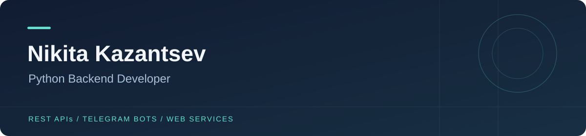

<a href="https://t.me/nickkoba">Telegram</a> · <a href="mailto:kazantsev.neckit@yandex.ru">Email</a> · <a href="README.md">English</a>

Разрабатываю веб-сервисы, REST API и Telegram-ботов на Python. В проектах работаю с авторизацией, каталогами рецептов, загрузкой файлов и развёртыванием в контейнерах.

### Технологии

**Python** · Django · Django REST Framework · Flask  
**Данные** · PostgreSQL · SQLite · SQLAlchemy  
**Инструменты** · Docker · Nginx · GitHub Actions · pytest · aiohttp

### Проекты

| Проект | Задача | Технологии |
| --- | --- | --- |
| [Recipes](https://github.com/KobaLuck/Recipes) | Рецепты, подписки, избранное и список покупок | Django · DRF · React · PostgreSQL |
| [Recipes + Telegram](https://github.com/KobaLuck/recipe_bot_site) | Сайт рецептов с интерфейсом в Telegram | Django · React · python-telegram-bot |
| [Recipe Bot](https://github.com/KobaLuck/recipe_bot) | Telegram-клиент для API Recipes | Python · aiohttp · Flask |
| [YaCut](https://github.com/KobaLuck/short_link) | Короткие ссылки, API и загрузка на Яндекс.Диск | Flask · SQLAlchemy · aiohttp |
| [Choose the Movie](https://github.com/KobaLuck/choose_the_movie) | Мнения о фильмах, REST API и загрузка изображений | Flask · SQLAlchemy · Dropbox |
| [Million Dogs](https://github.com/KobaLuck/million_dogs) | Синхронная и асинхронная загрузка фотографий | requests · aiohttp · asyncio |

### Связаться

Telegram: [@nickkoba](https://t.me/nickkoba) · [Написать на почту](mailto:kazantsev.neckit@yandex.ru).
